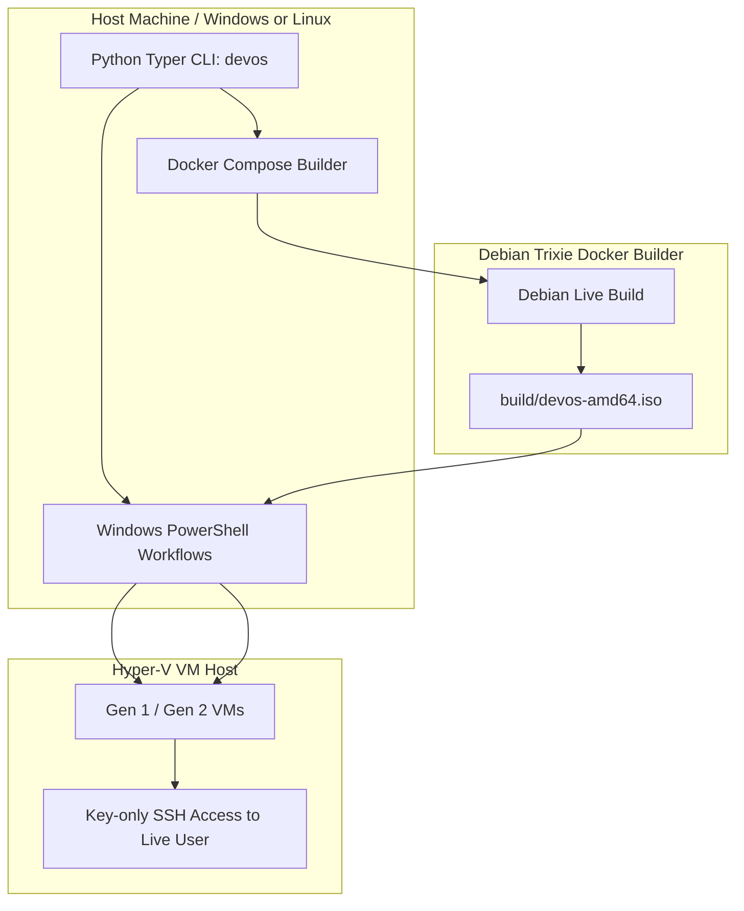
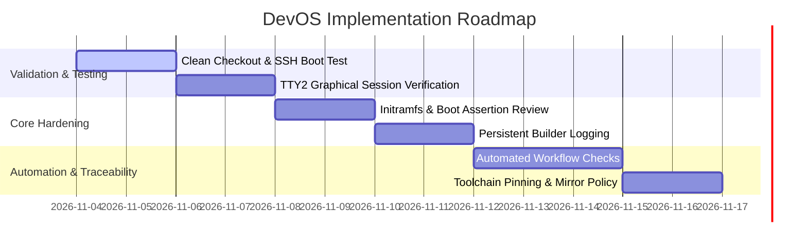

# Project Analysis & Action Plan: DevOS

## Executive Summary

DevOS is a specialized, work-in-progress framework for generating a lightweight, development-focused Debian 13 (Trixie) AMD64 Live ISO. It relies on a Python Typer CLI (`devos`), a containerized Debian Live Build environment managed via Docker Compose, and Windows PowerShell helpers for Hyper-V VM workflows and remote ISO transport.

A thorough review of project documentation (`README.md`, [`docs/architecture.md`](docs/architecture.md), [`docs/development.md`](docs/development.md), [`docs/testing.md`](docs/testing.md)), CLI implementation ([`src/devos/cli.py`](src/devos/cli.py)), and build scripts indicates a robust architecture with several known technical gaps, operational risks, and validation items.

---

## Architecture & Workflow

---

## Key Findings & Identified Gaps

1. **Hyper-V Initramfs Modules:** The current initramfs configuration lacks explicit confirmation for all required VMBus/storage modules for reliable Generation 2 boot across varying host environments.
2. **ISO Verification Limitations:** [`scripts/verify-iso.sh`](scripts/verify-iso.sh) validates SHA-256 and El Torito catalog structure, but does not perform end-to-end boot emulation tests.
3. **Builder Log Retention:** Because builds run via `docker compose run --rm`, past build logs are lost when containers exit, restricting [`devos logs`](src/devos/cli.py:439) to active service runs only.
4. **VM State Checking:** `Get-DevOSVmIp.ps1` needs stricter enforcement on VM running state when selecting by name vs auto-selection.
5. **Toolchain Reproducibility:** The builder relies on the moving `debian:trixie-slim` tag without package version locking, leading to potential nondeterministic builds over time.
6. **Automated Testing Suite:** The project relies exclusively on manual validation checklists in [`docs/testing.md`](docs/testing.md).

---

## Action Plan & Roadmap

### Actionable Implementation Steps

1. **Clean Checkout & Key-Only SSH Validation**
   - Execute a clean build from repository root following [`docs/testing.md`](docs/testing.md).
   - Boot the resulting ISO in a disposable Hyper-V VM and verify key-only SSH login without passwords.

2. **TTY2 Automatic Login & Graphical Session Testing**
   - Validate systemd `getty@tty2.service` drop-in and chroot hooks.
   - Confirm automatic login on `tty2`, Zsh shell initialization, and Openbox/Kitty fullscreen startup.

3. **Initramfs & Boot Verification Strengthening**
   - Audit [`config/includes.chroot/etc/initramfs-tools/modules`](config/includes.chroot/etc/initramfs-tools/modules) for complete Hyper-V storage/VMBus coverage.
   - Enhance verification scripts to assert BIOS and UEFI boot entries explicitly.

4. **Builder Log Persistence & PowerShell Improvements**
   - Refactor build container lifecycle or log capture mechanism so [`devos logs`](src/devos/cli.py:439) successfully retains logs across completed and failed runs.
   - Tighten Hyper-V state checks in `Get-DevOSVmIp.ps1`.

5. **Automated Testing & Toolchain Pinning**
   - Introduce automated checks for CLI command validation and PowerShell helper scripts.
   - Pin the builder image tag or digest for reproducible builds.
