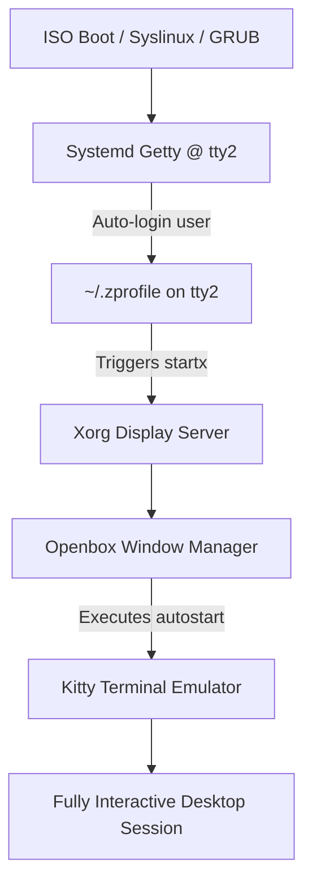

# Architectural Solution: Resolving Unresponsive Input & Blank Screen After Live Boot

## Overview

This document specifies the technical architecture and implementation design for resolving the post-boot unresponsive input and blank screen issue observed when running the DevOS Live ISO in virtualized environments (such as VirtualBox, Hyper-V, and VMware).

---

## Architecture & Boot Flow



---

## Root Causes Addressed

1. **Empty Openbox Session (Blank Screen)**: Openbox starts without any default window spawning, presenting only an X cursor on a gray root window.
2. **Input Driver Fallback**: Standard virtual machine guests require robust input driver support (`xserver-xorg-input-all`).
3. **Session Race Conditions**: Automatic `startx` invocation immediately upon shell startup can occasionally outpace udev input device enumeration.

---

## Implementation Design & Components

### 1. Openbox Autostart Configuration
Create `config/includes.chroot/etc/skel/.config/openbox/autostart` to automatically launch `kitty` upon entering the graphical session:
```sh
# DevOS Openbox Autostart
# Automatically launch fullscreen/default terminal emulator
kitty &
```

### 2. Openbox Keybindings (`rc.xml`)
Provide fallback keybindings in `config/includes.chroot/etc/skel/.config/openbox/rc.xml` so users can spawn `kitty` via `Super+T` or `Ctrl+Alt+T` if autostart fails:
```xml
<keyboard>
  <keybind key="C-A-t">
    <action name="Execute">
      <command>kitty</command>
    </action>
  </keybind>
  <keybind key="W-t">
    <action name="Execute">
      <command>kitty</command>
    </action>
  </keybind>
</keyboard>
```

### 3. Package List Enrichment
Ensure `xserver-xorg-input-all` is added to `config/package-lists/desktop.list.chroot` alongside `xserver-xorg-input-libinput` for robust hypervisor mouse/keyboard support.

---

## Actionable Execution Steps for Code Mode

1. Create directory `config/includes.chroot/etc/skel/.config/openbox/`.
2. Write the `autostart` script with executable permissions.
3. Update `desktop.list.chroot` to include `xserver-xorg-input-all`.
4. Rebuild the ISO using `devos build` and test in VirtualBox.
